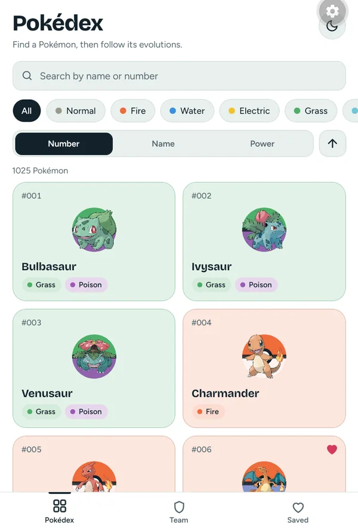
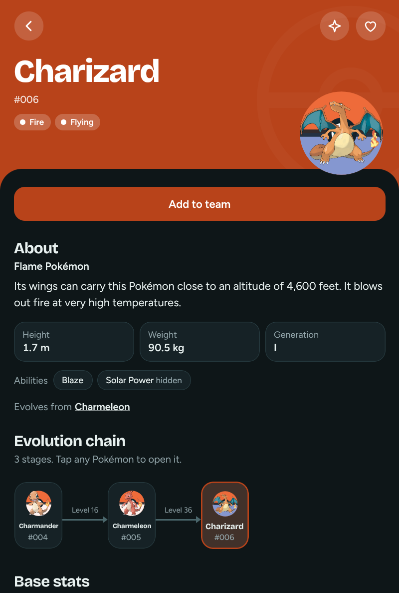
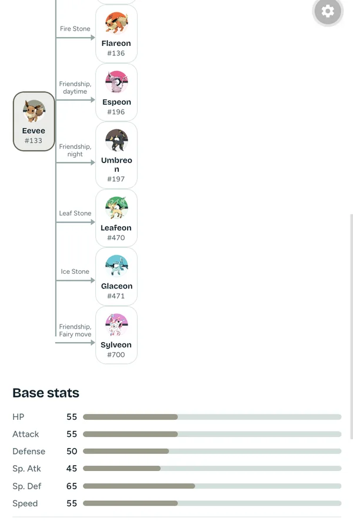
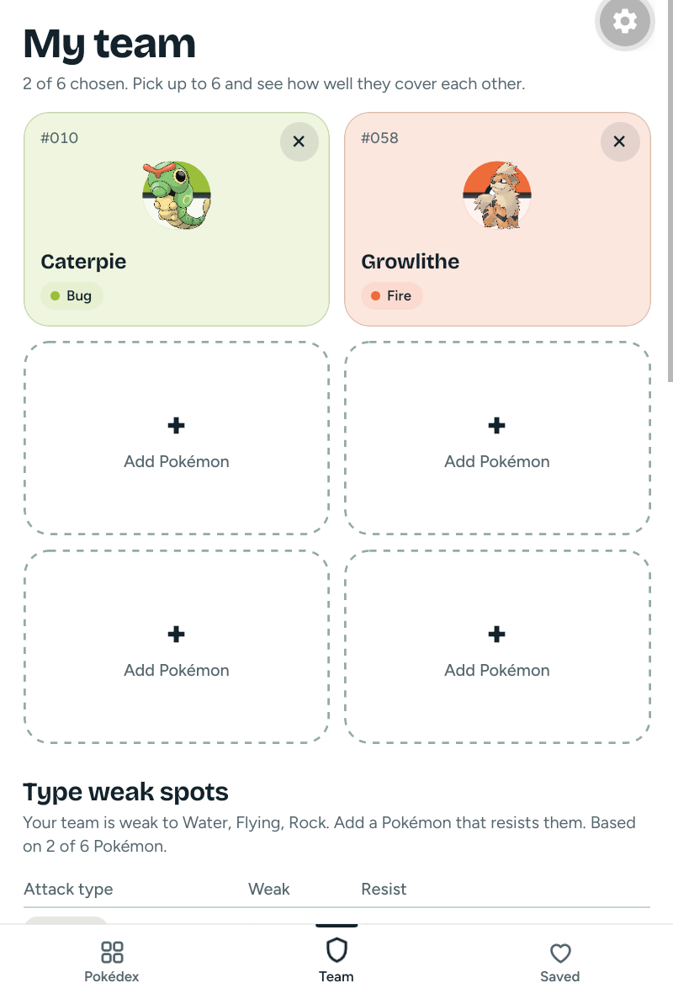

# Dexplorer

An offline-first Pokédex for Android, built with Expo and React Native. Browse all 1,025 Pokémon, follow their evolution lines, build a team of six and see where it's weak. Anything you've opened keeps working without an internet connection.

**Download** (Android 7.0 or newer): **[most phones, arm64 (39 MB)](https://github.com/ARMSTRONG-AISOSA/pokedex-mobile/releases/latest/download/dexplorer-arm64.apk)** · [older 32-bit phones, armv7 (31 MB)](https://github.com/ARMSTRONG-AISOSA/pokedex-mobile/releases/latest/download/dexplorer-armv7.apk) · [universal, any phone (114 MB)](https://github.com/ARMSTRONG-AISOSA/pokedex-mobile/releases/latest/download/dexplorer-universal.apk) · [all releases](https://github.com/ARMSTRONG-AISOSA/pokedex-mobile/releases)

**[Website](https://armstrong-aisosa.github.io/pokedex-mobile/)**

<p align="center">
  
  
  
  
</p>

## Features

- **The full Pokédex.** All 1,025 Pokémon in one list. Search by name or number, filter by any of the 18 types, and sort by number, name or total base stats.
- **Detail screens.** Official artwork with a shiny toggle, base stats, and type matchups: what each Pokémon is weak to, resists and is immune to.
- **About section.** Pokédex entry, category, height, weight, generation and abilities. Hidden abilities and baby Pokémon are marked. The section updates as you move along an evolution line.
- **Evolution trees.** Branching lines are drawn as a tree (Eevee has eight branches), with how each evolution happens: "Level 16", "Thunder Stone", "Friendship, night". Tap any Pokémon in the tree to jump to it.
- **Team builder.** Six slots, a weak-spot table that checks your team against all 18 attack types and flags the ones nobody covers, and the team's average stats.
- **Saved.** Tap the heart on any Pokémon to keep it in your Saved tab.
- **Works offline.** Pokémon data is cached in SQLite and artwork on disk. Cached data is shown instantly and refreshed quietly in the background once it's 30 days old.
- **Polish.** Light and dark mode, a launch animation, sliding tab and screen transitions, and haptic feedback. Animations respect the system's "remove animations" setting.
- **Accessibility.** Every button has a TalkBack label, touch targets are at least 44 dp, and layouts adapt to larger system text.

## Tech stack

| Area | Choice |
|---|---|
| Framework | Expo SDK 58, React Native 0.88, React 19, TypeScript |
| Navigation | Expo Router (file-based routes, typed) |
| Server state | TanStack Query |
| Offline cache | expo-sqlite (Pokémon, species, evolution chains, About text) |
| Small user data | AsyncStorage (team, favorites, settings) |
| Validation | zod, applied to every API response and every stored value |
| Animation | Reanimated 4 |
| Images | expo-image with a memory and disk cache |
| Graphics | react-native-svg |
| Data | [PokéAPI](https://pokeapi.co): REST and GraphQL |
| Quality | Jest (169 unit tests), ESLint, React Compiler |

## How it works

```
Screens (src/app, src/features)
   │  read through
Query hooks (TanStack Query)
   │  call
Repositories: read-through cache
   ├── SQLite: cached copy, shown first
   └── PokéAPI: fetched on a cache miss, or refreshed after 30 days
Domain logic (src/domain): pure TypeScript, unit tested
```

A few decisions that shaped the app:

- **One request for the whole list.** PokéAPI's REST list endpoint returns only names, so showing types and stats for 1,025 cards would take 1,025 requests. Instead, one GraphQL query fetches a compact summary of every Pokémon (about 25 KB compressed) and caches it. That's why sorting and filtering cover every Pokémon, not just the ones loaded so far. If that request fails, the list falls back to paging through the REST API, 20 at a time.
- **Show cached data first.** The repositories read SQLite before the network. Saved data appears instantly. Data older than 30 days is still shown, then refreshed in the background. Without a connection, the saved copy is simply kept.
- **Failures are typed.** Every failure becomes an `AppError` with a code: no connection, not found, rate limited, server error, or unreadable data. Each code has its own message and a retry button where retrying can help. A failure in one section, such as the evolution chain, doesn't take down the rest of the screen.
- **Nothing is trusted.** API responses and stored values are checked with zod schemas. Corrupt or outdated stored data falls back to safe defaults instead of crashing. If the database can't open at all, the app keeps working online and says so.
- **Logic lives outside the UI.** Type effectiveness, evolution tree parsing, sorting and team analysis are plain functions in `src/domain`, tested against real PokéAPI responses.

The full reasoning is in [ARCHITECTURE.md](ARCHITECTURE.md), including a log of every decision and the alternatives considered. The visual and motion spec is in [DESIGN.md](DESIGN.md).

## Project structure

```
src/
├── app/            Routes (Expo Router): tabs, the detail screen, root layout
├── features/       Screens and their parts: pokedex, detail, team, navigation, launch
├── components/ui/  Shared building blocks: type pills, chips, stat bars, skeletons…
├── domain/         Pure logic: type chart, evolution trees, sorting, team analysis
├── data/
│   ├── api/        PokéAPI client, zod schemas, response mapping
│   ├── db/         SQLite setup, migrations, repositories
│   ├── queries/    TanStack Query hooks
│   └── storage/    AsyncStorage helpers for team, favorites and settings
├── lib/            Errors, logging, haptics, request limiting
└── theme/          Colors (18 type colors, light and dark), type scale, motion curves
```

## Running it locally

You'll need [Node.js](https://nodejs.org) (LTS) and the **Expo Go** app on an Android phone (it must support SDK 58).

```bash
git clone https://github.com/ARMSTRONG-AISOSA/pokedex-mobile.git
cd pokedex-mobile
npm install
npx expo start
```

Scan the QR code with Expo Go. Your phone and computer need to be on the same Wi-Fi network.

Checks:

```bash
npm test            # unit tests
npm run lint        # ESLint
npx tsc --noEmit    # type check
```

## Releasing a new version

Builds run on Expo's servers with [EAS Build](https://docs.expo.dev/build/introduction/); the signing key is stored by Expo.

1. Raise `version` (for example `1.0.2`) and `android.versionCode` (by at least 1) in `app.json`, and commit.
2. Build the three APKs (profiles in `eas.json`):
   ```bash
   npx eas-cli build --platform android --profile apk-arm64   # 64-bit phones, the main download
   npx eas-cli build --platform android --profile apk-armv7   # older 32-bit phones
   npx eas-cli build --platform android --profile apk         # universal fallback, every CPU type
   ```
3. Download them, rename them to `dexplorer-arm64.apk`, `dexplorer-armv7.apk` and `dexplorer-universal.apk`, tag the build commit (`git tag -a v1.0.2`), and publish a GitHub Release with the three files.

Keep those three file names: the website and this README link to `releases/latest/download/<file name>`, which always serves the newest release.

## Testing

- **169 unit tests** cover the parts most likely to be subtly wrong:
  - the 18×18 type chart and dual-type multipliers
  - evolution tree parsing, including branching lines and choosing the right evolution method
  - sorting, filtering and team analysis
  - API error mapping and the cache freshness rules
  - storage fallbacks for corrupt data
- Test data comes from real PokéAPI responses saved as fixtures.
- Screens were checked on two real Android devices, a phone and a tablet, over wireless adb. Those checks covered failure cases forced on purpose, light and dark mode, 130% text size, and touch target sizes.

## What I learned

- **Designing around an API's shape.** The obvious approach (a list request, then one request per card) would have hammered PokéAPI and made sorting by stats impossible. Moving the list to a single GraphQL summary made the app faster and simpler.
- **Offline-first is mostly about deciding what's "fresh".** Caching was easy. Deciding when cached data is too old, and refreshing it without making the user wait, took more thought.
- **Real data has edge cases.** Evolution chains are recursive trees, some Pokémon evolve in several ways, and the first evolution method listed isn't always the main one. Leafeon showed a location-based method from an old game until I picked the right entry.
- **Test on real devices.** Some bugs only showed up on a phone. A sheet closed itself right after a fresh start, and the tab you'd just left kept catching taps for a moment during the slide animation. Screenshots and logs pulled over adb found both.

## Website

The promotional site lives in [`website/`](website/): plain HTML, CSS and JavaScript using the app's own design tokens, published to GitHub Pages by a GitHub Actions workflow. It has share links (with the phone's share sheet where available), link-preview tags for social networks and chat apps, and structured data and a sitemap for search engines. Its design system and architecture are in [website/pokedex-mobile-website.md](website/pokedex-mobile-website.md).

## Credits

- Pokémon data from [PokéAPI](https://pokeapi.co); artwork from the [PokeAPI sprites](https://github.com/PokeAPI/sprites) repository.
- Fonts: [Bricolage Grotesque](https://fonts.google.com/specimen/Bricolage+Grotesque) and [Figtree](https://fonts.google.com/specimen/Figtree).

## License

The code is released under the [MIT License](LICENSE). Pokémon data, names and artwork are not covered by this license; they belong to their owners (see below).

## Disclaimer

Dexplorer is an unofficial fan project. It is not affiliated with or endorsed by Nintendo, Game Freak, Creatures or The Pokémon Company. Pokémon and Pokémon character names are trademarks of Nintendo.
